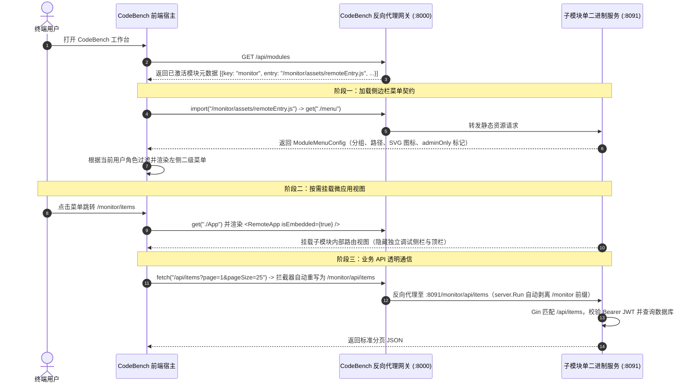

# 02 - 微前端契约与双模运行机制 🔌

本文深入解析子模块与 `code-bench` 宿主组装台之间的**运行时契约**、**路由协调机制**、**API 请求自动重写原理**以及**非共享 Context 隔离注意事项**。

---

## 1. 运行时交互全链路时序



---

## 2. 三大强制前端契约

### 契约一：Vite Module Federation 配置 (`frontend/vite.config.ts`)

1. **`federation.name`**：必须与 `code-bench/config.yaml` 中 `gateways` 下的键名（`module_key`）一致。
2. **`federation.filename`**：必须固定为 `'remoteEntry.js'`（Vite 构建后会输出在 `dist/assets/remoteEntry.js`，与宿主默认探测路径 `/<key>/assets/remoteEntry.js` 严格对应）。
3. **`federation.exposes`**：必须同时暴露两个入口：
   * `'./App': './src/App.tsx'`（默认导出根组件）
   * `'./menu': './src/menu.ts'`（导出菜单配置）
4. **`federation.shared`**：必须声明 `['react', 'react-dom', 'react-router-dom']`，确保子模块复用宿主的单例 React Hook 调度器与顶层 `BrowserRouter` 实例。
5. **`base` 与 `build.cssCodeSplit`**：
   * `base` **必须**设为 `'/<module_key>/'`（**首尾均带正斜杠 `/`**），否则子模块异步分片脚本会向宿主根路径 `/assets/...` 发起错误请求导致 404。
   * `build.cssCodeSplit` 建议设为 `false`，确保组件样式随入口可靠注入，避免微应用切换时样式闪烁或丢失。

---

### 契约二：菜单配置文件 (`frontend/src/menu.ts`)

宿主侧边栏通过加载 `./menu` 读取 `ModuleMenuConfig`：

```typescript
import type { ModuleMenuConfig } from '@code/common';

export const monitorMenuConfig: ModuleMenuConfig = {
  moduleKey: 'monitor',
  moduleName: '集群监控诊断',
  groups: [
    {
      title: '核心业务',
      items: [
        {
          path: '/dashboard',   // 相对子路径！宿主会自动拼接为 /monitor/dashboard
          label: '概览看板',
          icon: 'M3 12l2-2...', // 24x24 viewBox 的 SVG <path d="..." /> 字符串
        },
      ],
    },
    {
      title: '模块治理',
      adminOnly: true,          // 仅 super_admin 或 monitor_admin 角色可见
      items: [
        {
          path: '/admin/settings',
          label: '模块参数配置',
          adminOnly: true,
        },
      ],
    },
  ],
};

export default monitorMenuConfig;
```

* **动态菜单进阶能力**：如果你的模块需要根据后端数据动态增删菜单（例如按任务类型生成子菜单），只需在 `menu.ts` 中导出 `subscribeMenuChanges(listener)` 函数（模板 `frontend/src/menu.ts` 已内置标准实现）。宿主检测到该函数后会自动建立订阅，子模块调用 `notifyMenuUpdated(newConfig)` 即可实时刷新宿主左侧菜单栏！

---

### 契约三：双模根组件 (`frontend/src/App.tsx`)

宿主在挂载远程 `./App` 时会注入 두 个关键信号：
1. 组件属性：`isEmbedded={true}`
2. 全局标记：`window.__POWERED_BY_PORTAL__ = true`

模板在 `App.tsx` 中实现了开箱即用的双模分支：

| 维度 | 嵌入模式 (`isEmbedded === true`) | 独立调试模式 (`isEmbedded === false`) |
| :--- | :--- | :--- |
| **顶层 Router** | **不挂载** `BrowserRouter`（直接共享宿主 Router 上下文） | 挂载自身的 `<BrowserRouter basename={...}>` |
| **导航与顶栏** | **不渲染**独立侧栏/顶栏，直接输出页面工作区 | 渲染独立调试侧边栏、顶栏、主题切换按钮与退出按钮 |
| **未登录处理** | 由宿主门户统一拦截认证 | 渲染 `@code/common` 的 `<UnifiedLogin />` 独立登录页 |
| **内部页面路由跳转** | 使用 `appNavigatePath('/items', '/monitor')` 自动生成 `/monitor/items` | 使用 `appNavigatePath('/items', '/monitor')` 自动保持 `/items` |

> [!WARNING]
> **切勿在嵌入态下重复包裹 `<BrowserRouter>`！**  
> React Router v6 不允许在 `<BrowserRouter>` 内部再嵌套第二个 `<BrowserRouter>`，否则直接抛出运行时异常并触发 ErrorBoundary。请保持模板 `App.tsx` 中 `effectiveEmbedded ? <EmbeddedRoutes /> : <BrowserRouter>...</BrowserRouter>` 的结构不变。

---

## 3. API 前缀自动重写与跨门户通信机制

### 3.1 模块自身 API 调用（自动补全 `/<module_key>`）
在模板中，我们同时配置了双重保障：
1. **`src/api/client.ts`**：`createApiClient(getBaseUrl)` 在检测到 `window.__POWERED_BY_PORTAL__` 为真时，自动使用 `/<module_key>/api` 作为基准路径；独立调试时使用 `/api`。
2. **`App.tsx` 中的 `setupFetchInterceptor({ appPrefix: '/<module_key>' })`**：即使第三方组件（如 `MemberSearchSelect`）直接调用原生 `window.fetch('/api/users')`，拦截器也会在当前浏览器 URL 处于 `/<module_key>/*` 下时，自动将其重写为 `/<module_key>/api/users` 并附加 `Authorization: Bearer <token>` 请求头，且具备幂等防重拼接保护。

### 3.2 调用 CodeBench 宿主公共底座 API（旁路前缀重写）
如果子模块需要直接读取 CodeBench 宿主提供的全局公共接口（例如 `/api/departments` 部门树、`/api/repos` 代码仓台账），请使用 `src/api/client.ts` 中封装好的 `portalApiRequest`：

```typescript
import { portalApiRequest } from '../api/client';

// 内部会自动注入 'X-Portal-Request: true' 请求头，绕过子模块前缀重写，直达宿主 /api/departments
const depts = await portalApiRequest('/api/departments');
```

---

## 4. 关键避坑：为什么子模块 `App.tsx` 内必须包裹 `ConfirmProvider` 与 `ToastProvider`？

在 `vite.config.ts` 中，`shared` 仅共享了 `['react', 'react-dom', 'react-router-dom']`，而 `@code/common` 是随各子模块独立打包的编译期源码库。  
这意味着**子模块内的 `useConfirm()` / `useToast()` 与宿主门户内的 Provider 并不指向同一个内存 Context 引用**。  
因此，模板在 `frontend/src/App.tsx` 根部显式包裹了 `<ConfirmProvider>` 与 `<ToastProvider>` —— 请在开发业务时保留这两层包裹，即可在任意业务组件中安全调用 `useConfirm()` 与 `useToast()`。
