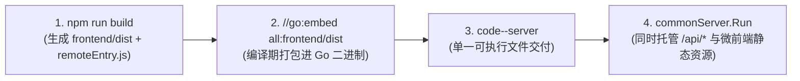

# 05 - 联调构建与生产部署指南 📦

本文说明如何利用标准 `Makefile` 完成单二进制全栈构建、规划多模块端口，并在 `code-bench` 与反向代理网关中完成生产级部署上线。

---

## 1. 全栈单二进制构建原理 (`go:embed`)

平台所有业务子系统均采用 **“前端静态资源内嵌进 Go 单一可执行文件”** 的极简交付模型：



执行标准构建流水线：

```bash
# 1. 安装前端依赖（首次或 package.json 变更时）
make install

# 2. 前端静态检查（tsc --noEmit + eslint，严禁 any 类型与未使用变量）
make lint

# 3. 后端代码格式化、静态分析与单元测试（go fmt + go vet + go test）
make test

# 4. 完整构建单二进制（内部自动串联前端构建与后端 go build，注入 Git 版本号与编译时间）
make build
```

构建完成后，工程根目录下即产出单个可执行文件（如 `code-monitor-server`），生产机器上只需拷贝该二进制与对应的 `config.yaml` 即可直接运行，无需在生产服务器安装 Node.js 或 Nginx！

---

## 2. 平台端口分配规划建议

为避免多个业务团队并行开发模块时出现本地联调端口冲突，建议遵守以下端口段约定：

| 模块类别 | 模块名称 / Key | Go 后端默认端口 | 前端 Vite 调试端口 |
| :--- | :--- | :---: | :---: |
| **宿主组装台** | `code-bench` (Portal) | `:8000` | `5173` |
| **平台核心模块** | `code-shield` (`shield`) | `:8080` | `5174` |
| **平台核心模块** | `code-proto` (`proto`) | `:8084` | `5175` |
| **平台核心模块** | `code-pipeline` (`pipeline`) | `:8082` | `5176` |
| **平台核心模块** | `code-pdm` (`pdm`) | `:8085` | `5177` |
| **平台核心模块** | `code-gate` (`gate`) | `:8088` | `5178` |
| **官方模板工程** | `code-template` (`template`) | `:8090` | `5180` |
| **扩展业务模块** | **自研新模块推荐段** | **`:8091` ~ `:8199`** | **`5181` ~ `5299`** |

---

## 3. 在 `code-bench/config.yaml` 中挂接模块

打开宿主配置文件 `code-bench/config.yaml`，在 `gateways` 下新增你的模块配置：

```yaml
gateways:
  shield: "http://127.0.0.1:8080"
  pipeline: "http://127.0.0.1:8082"
  pdm: "http://127.0.0.1:8085"

  # ── 挂接新开发的业务模块（推荐使用完整对象格式） ──
  monitor:
    url: "http://127.0.0.1:8091"                  # 子模块后端监听地址（也可填内网其他物理机/容器地址）
    title: "集群监控诊断"                          # 左侧一级菜单与工作台首页卡片标题
    icon: "Activity"                              # 门户一级图标（见下方已注册图标表）
    description: "实时监控集群节点健康水位与告警看护" # 工作台首页入口卡片描述文案
    super_admin_only: false                       # 若设为 true，则仅超级管理员可见该模块入口
```

### CodeBench 门户原生支持的 `icon` 图标列表
`code-bench` 宿主内置注册了以下 Lucide 图标关键字（若未填写或填写了未注册名称，将安全回退显示为 `Layers`）：

| 图标关键字 (`icon`) | 视觉图形语义 | 推荐适用业务场景 |
| :--- | :--- | :--- |
| `Shield` | 盾牌安全 | 代码安全、漏洞扫描、合规治理 |
| `Activity` | 脉冲电波 | 持续集成、实时监控、性能诊断 |
| `ClipboardList` | 清单台账 | 产品数据管理、资产台账、工单计划 |
| `FileCode` | 代码文稿 | 接口协议、文档规范、配置模板 |
| `Bot` / `Brain` | 智能机器人 / 大脑 | AI 网关、Agent 助手、大模型评测 |
| `Cpu` / `Server` | 芯片算力 / 服务器 | 算力调度、主机集群、环境管理 |
| `Database` | 数据库仓储 | 数据资产、元数据中心、备份归档 |
| `FolderGit2` / `Code2` | Git 分支 / 源码 | 代码仓库治理、MR 评审、分支看护 |
| `Box` / `Package` | 容器 / 制品包 | 镜像制品库、依赖包治理、部署发布 |
| `Terminal` / `Wrench` | 终端 / 运维扳手 | 自动化运维脚本、工具箱、环境巡检 |
| `Gauge` / `Workflow` | 仪表盘 / 工作流 | 效能度量看板、审批编排流 |
| `Globe` / `Bell` | 网络 / 消息铃铛 | 域名网关、统一消息通知中心 |
| `Layers` | 多层堆叠（默认） | 综合微应用系统 |

---

## 4. 生产环境部署与网关架构要点

1. **统一对外入口（Caddy 反代）**：
   外部浏览器流量统一经由 `Caddyfile`（`:80` / `:443`）反向代理至 `code-bench`（`:8000`），再由 `code-bench` 内置的动态网关按 `/<module_key>/*` 转发至各业务子服务。子服务端口（如 `:8091`）仅需对 `code-bench` 所在内网可达，无需直接暴露至公网。
2. **生产环境安全配置项检查**：
   * `auth.standalone_mode`：生产嵌入部署时建议设为 `false`，统一收敛由 CodeBench 门户登录与签发 Token。
   * `auth.jwt_secret`：严禁留空或使用弱口令，必须与 `code-bench` 保持一致的高强度随机密钥（推荐通过环境变量 `JWT_SECRET` 注入）。
   * `database.sslmode`：跨主机连接数据库时建议开启 `require` 或 `verify-full`。
3. **平滑发版与前端缓存刷新**：
   构建插件 `versionTrackerPlugin` 会在每次打包时自动生成包含最新 Git Commit Hash 与构建时间戳的 `version.json`，配合 `setupChunkErrorReloader()`，当子模块重新编译上线后，在线用户若触发旧分片加载失败会自动无感重载最新版本。
