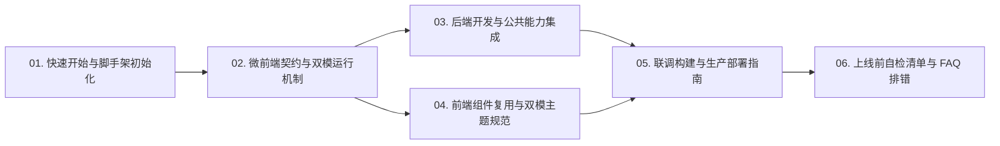

# Code-Template 业务模块开发指导文档中心 📚

欢迎使用 **`code-template`** 微前端业务模块标准脚手架！  
本目录汇集了将自定义业务模块快速开发并挂接到 **CodeBench（微前端组装台）** 所需的全套实战手册、架构契约与避坑清单。

---

## 🗺️ 文档阅读路线图

无论你是第一次接触平台的新成员，还是准备将模块提测上线的模块负责人，都可以按以下顺序按需查阅：

| 序号 | 文档标题 | 适用对象 | 核心解决的问题 |
| :---: | :--- | :--- | :--- |
| **01** | [01-快速开始与脚手架初始化.md](./01-快速开始与脚手架初始化.md) | 全体开发者 | 如何准备并排目录环境、用 `init-module.sh` 3 分钟派生新模块并首次挂载进 CodeBench？ |
| **02** | [02-微前端契约与双模运行机制.md](./02-微前端契约与双模运行机制.md) | 前端 / 全栈 | Vite 模块联邦如何暴露 `./App` 与 `./menu`？嵌入态与独立调试态如何无缝切换？API 前缀如何自动重写？ |
| **03** | [03-后端开发与公共能力集成指南.md](./03-后端开发与公共能力集成指南.md) | Go 后端 | 如何复用 `code-common/backend` 实现前缀自动剥离、JWT/RBAC 鉴权、共享数据库表名隔离、操作审计与隔离单测？ |
| **04** | [04-前端组件复用与双模主题规范.md](./04-前端组件复用与双模主题规范.md) | React 前端 | 如何使用 `@code/common` 标准分页、抽屉、二次确认与成员选择？如何严格遵守亮/暗双模 `--color-*` 规范？ |
| **05** | [05-联调构建与生产部署指南.md](./05-联调构建与生产部署指南.md) | 模块负责人 / 运维 | 单二进制 `go:embed` 打包流程是什么？端口如何规划？`code-bench/config.yaml` 的 `gateways` 支持哪些配置与图标？ |
| **06** | [06-上线前自检清单与常见问题排查.md](./06-上线前自检清单与常见问题排查.md) | 提测与排障 | 模块上线前哪 15 项必须自检通过？遇到 `remoteEntry.js` 404、白屏、API 401、亮色黑块如何快速定位？ |

---

## 🧩 模板工程示范能力对照表

在阅读文档时，你可以直接对照本模板工程中已实现的真实运行代码：

| 平台标准能力 | 后端示范源码位置 | 前端示范源码位置 |
| :--- | :--- | :--- |
| **集中元数据与常量** | `config/config.go` (`ModuleKey` / `TablePrefix` / `AdminRole`) | `frontend/src/constants.ts` |
| **微前端入口与动态菜单** | `main.go` (`commonServer.Run` + `Prefix`) | `frontend/vite.config.ts`、`frontend/src/menu.ts` |
| **嵌入态 / 独立态双模外壳** | `handlers/auth.go` (`StandaloneMode` 登录支持) | `frontend/src/App.tsx` (`EmbeddedRoutes` / `StandaloneShell`) |
| **URL 同步分页 + 搜索过滤** | `handlers/item.go` (`utils.ParsePagination` + `utils.PaginatedJSON`) | `frontend/src/pages/ItemListPage.tsx` (`usePagination` + `Pagination`) |
| **抽屉表单 + 成员检索 + 二次确认** | `handlers/auth.go` (`SearchUsers`)、`handlers/item.go` | `frontend/src/pages/ItemListPage.tsx` (`Drawer` / `MemberSearchSelect` / `useConfirm`) |
| **模块管理员 RBAC + 审计 Diff** | `main.go` (`RequireAdmin`)、`handlers/settings.go` (`SetAuditContext`) | `frontend/src/menu.ts` (`adminOnly`)、`frontend/src/pages/AdminSettingsPage.tsx` |
| **物理隔离数据库单测** | `handlers/item_test.go` (`testdb.SetupIsolatedDB`) | - |
